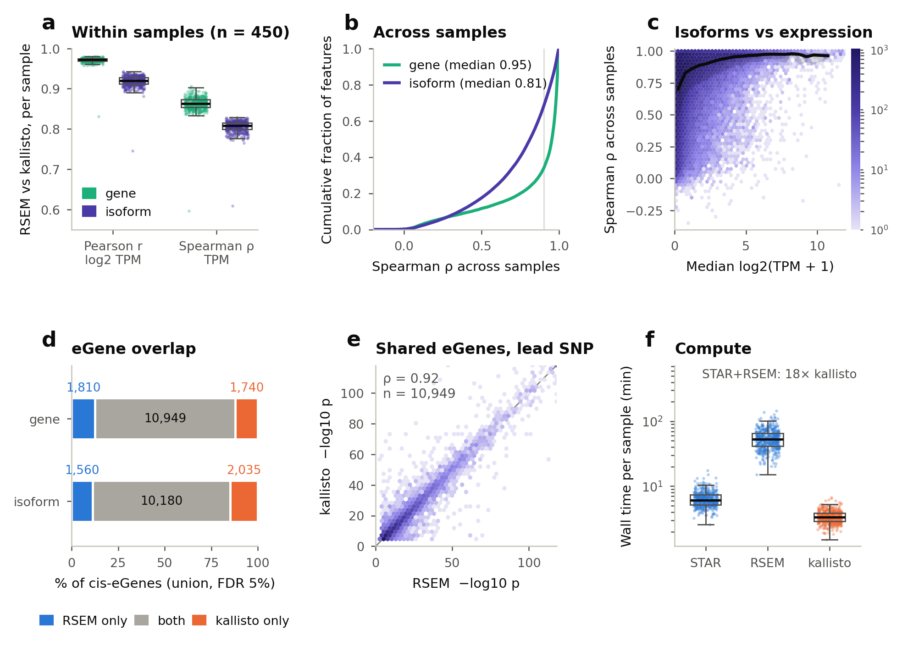

# kallisto vs STAR+RSEM benchmark

Snakemake pipeline comparing **kallisto** (pseudoalignment) with **STAR + RSEM** (alignment) on 450 Geuvadis
lymphoblastoid cell lines with 1000 Genomes 30x genotypes. Both tools start from the same raw reads and quantify the
same transcripts (Ensembl 110); everything downstream uses identical code. The tools are compared within and across
samples, at gene and isoform level, and through cis-eQTL discovery with tensorQTL.



- **a** Per-sample agreement between RSEM and kallisto across all 450 samples (Pearson r on log2 TPM, Spearman ρ on TPM), gene vs isoform.
- **b** Per-feature agreement across samples: cumulative distribution of Spearman ρ for expressed genes and isoforms.
- **c** Isoform agreement rises with expression level (line = binned median); low-expression isoforms diverge most.
- **d** Overlap of cis-eGenes (FDR 5%) between the tools, gene level and isoform level (isoforms grouped by gene).
- **e** Lead-SNP significance (−log10 p) for eGenes found by both tools, gene level.
- **f** Wall time per sample for STAR, RSEM and kallisto (log scale).

|                                                        | Gene            | Isoform         |
| ------------------------------------------------------ | --------------- | --------------- |
| Within-sample Pearson r, log2 TPM (median)             | 0.97            | 0.92            |
| Across-sample Spearman ρ, expressed features (median) | 0.95            | 0.81            |
| cis-eGenes, STAR+RSEM / kallisto (FDR 5%)              | 12,759 / 12,689 | 11,740 / 12,215 |
| eGene overlap (Jaccard)                                | 0.76            | 0.74            |

Jaccard depends on the FDR cutoff (an eGene just past 5% in one tool counts as a mismatch); at gene level, 86% of
each tool's eGenes are also eGenes in the other.

Gene-level expression and eQTLs are essentially interchangeable; isoform estimates diverge for lowly expressed
isoforms and complex genes. kallisto is ~18× faster (median 3 vs 59 min per sample).

**Two outlier samples.** Two samples stand apart in mapping QC ([Fig. 1c](results/report/figures/Fig1_mapping_qc.png):
STAR uniquely mapped vs kallisto pseudoaligned; values in `results/summary/mapping_qc.tsv`) and are best
excluded from downstream analyses. The results above include all 450 samples.

- **NA18861**: only 42.5% of reads pseudoalign with kallisto (median 90.4%), and only 33% reach RSEM (median 83%),
  although STAR maps 87% uniquely to the genome. RSEM detects 46k genes (median 21k). It also has the lowest
  agreement between the tools (gene Pearson r 0.83, median 0.97). This pattern fits reads that fall outside
  annotated transcripts, e.g. genomic DNA or intronic signal.
- **HG00329**: 45% of reads are multi-mapped by STAR (median 7.6%), so only 50% map uniquely (median 89.7%). It has
  the fewest detected genes of all samples, though the tools still agree well on it (gene r 0.96).

## Pipeline

1. **References**: STAR index, RSEM reference, kallisto index on RSEM's transcript FASTA.
2. **Quantification**: STAR 2-pass → RSEM; kallisto. Both read the raw FASTQs, unstranded; samples with two
   sequencing runs are quantified jointly (one read group per run). Optional Trimmomatic step: `trimming: true`.
3. **Genotypes**: plink2 from the 1kGP 30x VCFs; PASS biallelic SNPs, MAF ≥ 0.01; chr1–22; genotype PCs.
4. **Phenotypes**: gene = sum of isoforms; GTEx-style filter, TMM, inverse normal transform; 10 genotype + 20 expression PCs.
5. **eQTL** (GPU): tensorQTL cis permutation, conditionally independent and nominal passes, 4 phenotype sets.
6. **Summary**: mapping QC, compute cost, tool agreement, eQTL overlap (`results/summary/`).

Inputs: see `data/README.md`. Outputs: see `results/README.md`. Figures: `python results/report/make_figures.py`.

## Running (SLURM)

Needs conda/mamba and an env with Snakemake ≥ 8 and `snakemake-executor-plugin-slurm`:

```bash
mamba create -n snakemake -c conda-forge -c bioconda snakemake snakemake-executor-plugin-slurm
```

1. Put the inputs in `data/` (or edit the paths in `config/config.yaml`).
2. Replace `YOUR_ACCOUNT`, `YOUR_CPU_PARTITION`, `YOUR_GPU_PARTITION` in `profiles/slurm/config.yaml` and in the
   `#SBATCH` lines of `run_pipeline.slurm`.
3. tensorQTL runs on a GPU (one per job) from the conda env `workflow/envs/tensorqtl.yaml`.
4. Submit the controller job, which sends each step to SLURM:

```bash
sbatch run_pipeline.slurm                                    # full pipeline
sbatch --export=ALL,TARGET=quant,SNAKEMAKE_ARGS="--config samples=config/samples_pilot.tsv" run_pipeline.slurm   # 2-sample pilot
sbatch --export=ALL,TARGET=trans run_pipeline.slurm          # optional trans-eQTL
sbatch --export=ALL,UNLOCK=1 run_pipeline.slurm              # restart after a killed controller job
```

Tools: STAR 2.7.10b, RSEM 1.3.3, kallisto 0.51.1, plink2, tensorQTL 1.0.10.

## Author

Mehdi Esmaeili-Fard (mehdi.esmaeilifard@gmail.com).

Completion date: February 2024.

## License

MIT, see [LICENSE](LICENSE).
